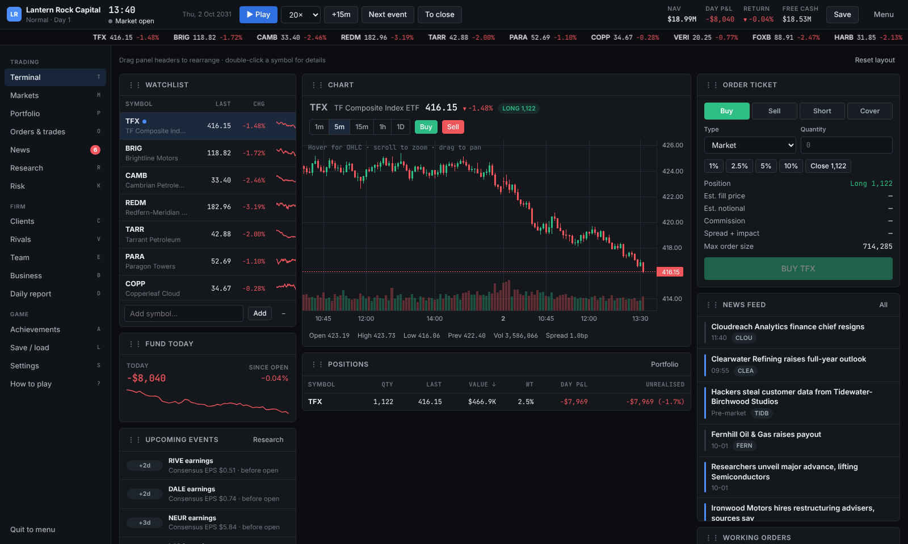

# Trading Floor

A browser-based hedge fund management and trading strategy game. Found a fund, trade a procedurally generated market of ~250 fictional instruments, react to news, manage risk, win investors, hire a team, and try to outlast seven rival funds. No download, no sign-up: open the page and play as a guest.



## Features

- **Living market:** 216 fictional equities across 18 sectors, 26 ETFs (broad, sector and thematic, priced from their baskets) and 6 commodities (gold, silver, crude, natural gas, copper, wheat). Every game is generated from a seed, so the same seed gives the same world.
- **Real simulation:** a minute-by-minute price engine with market and sector factors, commodity links, macro regimes (bull, range-bound, bear, crisis), fair-value drift and news shocks. The 1m, 5m, 15m, 1h and daily candles are all views of the same history.
- **News that moves markets:** 83 event templates plus scheduled earnings, CPI, jobs, GDP and central-bank decisions. Templates cover multi-day story chains (takeover rumours, probes, recalls, debt spirals, short attacks) and Hard-only crises.
- **Proper trading:** market, limit and stop orders, shorting with borrow fees and collateral, margin, slippage, spreads, commissions, forced liquidation, a full audit trail, and target allocations with one-click rebalancing.
- **Correct accounting:** cash is held in integer cents. The fund's NAV and the management company's books are separate ledgers. Returns are time-weighted (NAV per unit), so investor flows and fees never count as profit. Performance fees use per-client high-water marks.
- **The business layer:** clients with their own expectations, tolerances and mandates; prospects and pitches; redemptions with notice periods; analysts, portfolio managers and investor-relations staff with concrete effects; office tiers; automation; rival funds that hold real baskets in the same market.
- **Endless sandbox with real failure:** margin wipe-out, catastrophic drawdown, company insolvency, a fund too small to survive, or a collapse in investor confidence. Recoverable conditions show a countdown first.
- **Persistence:** IndexedDB saves with an autosave per game, five manual slots, validation, backup copies, schema migrations, and JSON export/import. Optional Supabase accounts add cloud saves and achievement sync.
- **Polish:** a skippable intro, a guided tutorial, dark and light themes, keyboard shortcuts, synthesised sound effects and optional ambient music, draggable terminal panels, and a responsive layout.

## Quick start

Requires Node 20+ (developed on Node 22).

```bash
npm install
npm run dev          # http://localhost:5173
```

| Script | What it does |
| --- | --- |
| `npm run dev` | Vite dev server with hot reload |
| `npm run build` | Strict type-check, then a production build into `dist/` |
| `npm run preview` | Serve the production build locally |
| `npm run typecheck` | TypeScript in strict mode, no emit |
| `npm run lint` | ESLint (TypeScript + React hooks rules) |
| `npm test` | Vitest unit and integration tests |
| `npm run e2e` | Playwright end-to-end tests (builds and serves on :4173) |

If Playwright browsers aren't installed, run `npx playwright install chromium` once.

## How to play

1. Before the open, read the overnight news and check the calendar.
2. Queue orders, then press **Open market** (or Space).
3. Trade through the 09:30–16:00 session. You can pause, change speed (keys 1–5), jump forward 15 minutes (`.`), skip to the next notable event (`>`), or run to the close.
4. At 16:00, read the end-of-day report.
5. After hours, handle clients, prospects, staff, office and costs.
6. Press **Next day** (Shift+Enter).

The in-game **How to play** page and the **?** shortcut list explain the rules.

## Architecture

```
src/
  config/        balance, difficulty, starting presets, sectors (all tunable numbers live here)
  game/          deterministic simulation engine (no React)
    rng.ts         seeded sfc32 PRNG, state persisted in saves
    calendar.ts    trading calendar, exchange time
    universe.ts    procedural instrument and fundamentals generation
    market.ts      price engine, OHLCV writer, overnight gaps
    macro.ts       macro variables and regime Markov chain
    events/        catalogue, effect mechanisms, scheduler, earnings and macro releases
    accounting.ts  the authoritative fund ledger and portfolio summary
    orders.ts      validation, execution, stops/limits, margin enforcement
    clients.ts     investors, flows, prospects, interactions
    company.ts     management company: fees, expenses, credit, office, automation
    rivals.ts      rival funds holding real baskets
    staff.ts       hiring and staff effects
    risk.ts, failure.ts, achievements.ts, rebalance.ts, decisions.ts
    sim.ts         lifecycle orchestration: stepMinute, closeDay, nextDay
    init.ts        newGame(setup)
  persistence/   SaveRepository interface, IndexedDB and Supabase implementations,
                 validation, migrations, JSON serialisation, career profile
  app/           controller (the single real-time loop), store hooks, router, settings, audio
  features/      screens (terminal, markets, portfolio, orders, news, research, risk,
                 clients, rivals, team, business, report, onboarding, meta)
  ui/            shared components, charts (lightweight-charts), formatting
e2e/             Playwright journeys
supabase/        optional cloud-save schema with row-level security
docs/            simulation & accounting model, deployment, requirements checklist
```

Design rules:

- The simulation never depends on React. The UI reads engine state and calls engine functions. Financial numbers on screen come from `summarize()` and the other engine selectors, never from separate UI formulas.
- One controller owns the only interval. It advances whole simulated minutes based on wall-clock time and the chosen speed, and publishes throttled updates (about 150 ms) to React. Pausing stops the interval, and navigating between screens never creates another loop.
- All randomness comes from four persisted RNG streams (market, events, clients, misc). A save restores the exact state, so reloading never rerolls prices, news or companies.

See [docs/SIMULATION.md](docs/SIMULATION.md) for the market, execution and accounting models.

## Optional accounts and cloud saves (Supabase)

The game is fully playable without a backend. To enable accounts:

1. Create a Supabase project.
2. In the SQL editor, run [`supabase/schema.sql`](supabase/schema.sql). It creates `cloud_saves` and `profiles` with row-level security, so users can only read and write their own rows.
3. Enable email/password auth (Authentication → Providers).
4. Copy `.env.example` to `.env.local` and set:
   ```
   VITE_SUPABASE_URL=https://YOUR-PROJECT.supabase.co
   VITE_SUPABASE_ANON_KEY=your-anon-public-key
   ```
   The anon key is a public client key; RLS enforces access. Never put the service-role key in the frontend.
5. Rebuild. The main menu then shows **Log in / Create account**. Signed-in players get:
   - manual saves mirrored to the cloud;
   - achievements and career history synced across devices;
   - a **Transfer guest saves** flow that warns before overwriting cloud slots.

If the variables are unset, all cloud code stays dormant: the Supabase client is loaded lazily and only when configured.

## Deployment

The game is hosted on **GitHub Pages**. The workflow in `.github/workflows/deploy.yml` tests, builds and publishes on every push to `main`. For a one-time setup, go to **Settings → Pages** and set **Source** to **GitHub Actions**. See [docs/DEPLOYMENT.md](docs/DEPLOYMENT.md).

The build is a static site in `dist/` with relative asset paths and hash routing, so it works at any sub-path:

```bash
npm ci && npm run build   # output: dist/
```

## Testing

- **Unit and integration (Vitest, 60+ tests):**
  - accounting invariants: NAV reconciliation, long and short P&L, commissions charged once, no double-counted P&L, flows aren't returns, fees, high-water marks, margin liquidation, ledger separation;
  - order execution: market, limit, stop with gaps, rejections, shorting, cancel and expiry, risk enforcement;
  - market: reproducibility, time-only dependence, candle validity, timeframe consistency, ETF tracking, no duplicate events, scheduled timing;
  - events: catalogue size, rendering, causal effects against a counterfactual world;
  - clients, rivals and difficulty;
  - failure rules;
  - persistence: deterministic resume, corruption and backup restore, export/import, migrations;
  - a 50-day multi-strategy stress test;
  - a React Testing Library test of the order ticket.
- **End-to-end (Playwright):** the full guest journey (create fund, pick difficulty, trade, advance time, check the position, read news, see prices move, close, report, next day, save, reload and resume, close the fund through the failure flow, start a new game), corrupted-save handling, and a narrow-screen layout check.

## Known limitations

- Orders fill in full (no partial fills). Orders above 10% of average daily volume are rejected and large orders pay square-root market impact.
- Commodities trade on the same 09:30–16:00 schedule as equities, as simplified exposure contracts per unit.
- Performance fees use per-client high-water marks; top-ups blend the client's mark (no series accounting or equalisation).
- Cloud save code is written against the Supabase JS client but couldn't be exercised end-to-end without a configured project. Guest and local play are fully tested.
- Save files are large (about 12 MB JSON or 6 MB gzipped for an exported save) because they keep full multi-timeframe price history.
- Fonts load from Google Fonts. Without network access the UI falls back to system fonts.

## Licence

Game code © the Trading Floor authors. All companies, people and data in the game are fictional.
